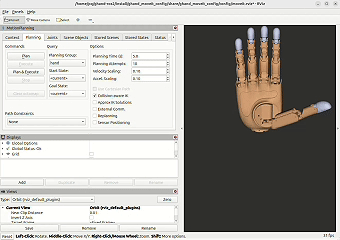
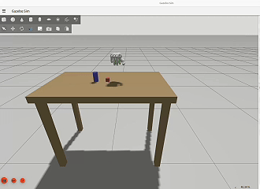

# GHand-ROS2

[](CHANGELOG.md)
[](LICENSE)
[](https://docs.ros.org/)
[](https://en.cppreference.com/w/cpp/17)
[](https://www.python.org/)

[简体中文](README_CN.md)

GHand-ROS2 is a ROS 2 control stack for the GHand five-finger dexterous hand, built on the `ros2_control` framework. It supports Gazebo physical simulation, MoveIt 2 motion planning, and multiple real-hardware communication backends (EtherCAT, CANFD, RS485), enabling algorithm development and visualization verification without hardware.

## 🎬 Demo

### MoveIt Motion Planning



### Gazebo Simulation



## ✨ Features

- **Multi-backend hardware drivers**
  - Supports EtherCAT, CANFD, and RS485 communication.
  - Switch backend and device configuration with a single `profile` argument.
  - Unified hardware abstraction layer with consistent interfaces for real and mock hardware.

- **ros2_control integration**
  - Implements `hardware_interface::SystemInterface` lifecycle management.
  - Cyclic read/write of joint commands and states; supports position, velocity, and effort control modes.

- **Custom broadcasters**
  - `joint_status_broadcaster` publishes joint status and error codes.
  - `tactile_broadcaster` publishes tactile resultant force and distributed forces.

- **Simulation and motion planning**
  - Built-in Gazebo Harmonic launch files and ROS 2 Control plugin configuration.
  - Built-in MoveIt 2 configuration for trajectory planning and execution in RViz.

- **Scenario-based launch**
  - `ghand_bringup` handles real / mock hardware launch; `ghand_hardware_interface` provides the hardware plugin.
  - `ghand_gazebo` handles physical simulation launch; the two are decoupled.

## 📖 Official Documentation

For detailed technical specifications, API reference, and tutorials, see the [GHand Dexterous Hand Documentation](https://fcnzogxju7xr.feishu.cn/docx/AhZ6ds2iCoguaAxIzBxciYHinNo).

The frozen core ROS 2 API is documented in
[docs/ROS2_INTERFACE_REFERENCE.md](docs/ROS2_INTERFACE_REFERENCE.md).

## 📑 Table of Contents

- [Features](#-features)
- [Official Documentation](#-official-documentation)
- [System Requirements](#-system-requirements)
- [Dependencies](#-dependencies)
- [Installation](#-installation)
- [Quick Start](#-quick-start)
- [Demo](#-demo)
- [Control Interfaces](#-control-interfaces)
- [Directory Structure](#-directory-structure)
- [Open Source and Ecosystem](#-open-source-and-ecosystem)
- [Changelog](#-changelog)
- [Support and Feedback](#-support-and-feedback)
- [License](#-license)

## 💻 System Requirements

### Supported Platforms

| Platform | Requirement |
| -------- | ----------- |
| **Operating System** | Ubuntu 24.04 LTS |
| **ROS 2** | Jazzy Jalisco |
| **Compiler** | GCC 11+ (C++17 support) |
| **Python** | 3.10 or newer |
| **Simulator** | Gazebo Harmonic (required for physical simulation) |

## 🔧 Dependencies

### Required Dependencies

```bash
sudo apt update
sudo apt install -y \
  ros-${ROS_DISTRO}-ros2-control \
  ros-${ROS_DISTRO}-ros2-controllers \
  ros-${ROS_DISTRO}-moveit \
  ros-${ROS_DISTRO}-joint-state-publisher-gui \
  ros-${ROS_DISTRO}-rviz2
```

> Replace `${ROS_DISTRO}` with `jazzy`.

### Optional Hardware Dependencies

Only needed when connecting to real hardware; pure simulation development can skip these.

| Backend | Dependency / Library | Notes |
| ------- | -------------------- | ----- |
| EtherCAT | `libsoem` / SOEM | Build from source; CMake auto-detects |
| RS485 | `libmodbus` | System package |
| CANFD | GHand-Cpp-SDK | ZQWL CDC serial CANFD adapter |

## 📦 Installation

### 1. Environment Setup

```bash
# Verify ROS 2 environment
echo $ROS_DISTRO  # should output: jazzy

# Create workspace
mkdir -p <workspace>/src
cd <workspace>
```

**Note**: Replace `<workspace>` with your workspace path, e.g., `~/ghand-ros2`.

### 2. Clone the Repository

```bash
# Enter workspace src directory
cd <workspace>/src

# Clone the main repository
git clone https://gitee.com/glitech/ghand-ros2.git
```

### 3. Import External Dependencies

The URDF/Xacro and STL meshes for `ghand_description` are provided by external repositories. Import them via `ghand.repos`:

```bash
cd <workspace>/src
vcs import . < ghand-ros2/ghand.repos --recursive --skip-existing
```

**Note**: If `vcs` is not installed, install it first:
```bash
sudo apt-get install python3-vcstool
```

### 4. Build

```bash
cd <workspace>
colcon build --symlink-install
source install/setup.bash
```

For mock-hardware-only builds, you can also use:

```bash
cd <workspace>
./src/ghand-ros2/build.sh
source install/setup.bash
```

## 🚀 Quick Start

### Launch Simulation (No Hardware Required)

```bash
ros2 launch ghand_bringup ghand.launch.py use_mock_hardware:=true
```

Add `hand_side:=left` to use the left-hand model. The default is `right`.

Simulation mode uses `mock_components/GenericSystem` and requires no hardware devices.

### Launch Real Hardware

```bash
ros2 launch ghand_bringup ghand.launch.py profile:=ethercat_default ifname:=enx000000000000
```

> Replace `enx000000000000` with your actual EtherCAT network interface name. Use `ip link` to list available interfaces.

Available communication profiles are located at `ghand_bringup/config/profiles/` and include `ethercat_default`, `rs485_left`, `rs485_right`, `canfd_left`, and `canfd_right`. The `zqwl_canfd_left/right` names remain as compatibility aliases.

### Launch MoveIt 2

All hardware, MoveIt and Gazebo launch files accept `product_name:=ghand5`
(the default). Product data is isolated inside the existing packages under
`config/<product_name>/`; the hardware plugin and launch code stay shared.
Supported product configurations are `ghand5` and `ghandlite1` (11 feedback
joints, six active joints). For Lite1 mock control:

```bash
ros2 launch ghand_bringup ghand.launch.py product_name:=ghandlite1 use_mock_hardware:=true
```

Lite1 source/configuration adaptation has offline coverage; target ROS builds,
Gazebo/MoveIt startup and live hardware behavior still require validation.
See [product configuration and migration notes](ghand_bringup/README.md#product-selection).

```bash
ros2 launch ghand_moveit_config moveit.launch.py
```

The right-hand model is used by default. Select the left hand with:

```bash
ros2 launch ghand_moveit_config moveit.launch.py hand_side:=left
```

For EtherCAT real hardware, also provide `ifname`:

```bash
ros2 launch ghand_moveit_config moveit.launch.py use_sim:=false profile:=ethercat_default ifname:=enx000000000000
```

### Launch Gazebo Simulation

```bash
ros2 launch ghand_gazebo ghand_gazebo.launch.py
```

Pass `hand_side:=left` to simulate the left hand instead:

```bash
ros2 launch ghand_gazebo ghand_gazebo.launch.py hand_side:=left
```

After launch, you can plan trajectories in RViz using the MotionPlanning plugin; trajectories are sent to the `joint_trajectory_controller` running in Gazebo.

## 🎮 Control Interfaces

### Topic Interfaces

- **Joint States**: `/joint_states` (`sensor_msgs/JointState`)
- **Joint Status / Error Codes**: `/joint_status` (`ghand_msgs/JointStatus`)
- **Tactile Feedback**: `/tactile_data` (`ghand_msgs/TactileData`)
- **Trajectory Commands**: `/joint_trajectory_controller/joint_trajectory` (`trajectory_msgs/JointTrajectory`)

### Action Interfaces

- **Trajectory Execution**: `/joint_trajectory_controller/follow_joint_trajectory` (`control_msgs/action/FollowJointTrajectory`)

### Control Examples

Start the hardware or simulation first:

```bash
# mock hardware
ros2 launch ghand_bringup ghand.launch.py use_mock_hardware:=true

# or Gazebo simulation
ros2 launch ghand_gazebo ghand_gazebo.launch.py
```

#### Open Palm

```bash
ros2 topic pub --once /joint_trajectory_controller/joint_trajectory \
  trajectory_msgs/msg/JointTrajectory \
  '{
    joint_names: ["Thumb_MCP", "Thumb_TMC_FE", "Thumb_TMC_AA", "Thumb_TMC_PS",
                  "FF_PIP", "FF_MCP", "FF_MCP_AA",
                  "MF_PIP", "MF_MCP",
                  "RF_PIP", "RF_MCP",
                  "LF_PIP", "LF_MCP"],
    points: [{
      positions: [0.0, 0.0, 0.349, 0.0, 0.0, 0.0, 0.0, 0.0, 0.0, 0.0, 0.0, 0.0, 0.0],
      time_from_start: {sec: 1}
    }]
  }'
```

#### Make Fist

```bash
ros2 topic pub --once /joint_trajectory_controller/joint_trajectory \
  trajectory_msgs/msg/JointTrajectory \
  '{
    joint_names: ["Thumb_MCP", "Thumb_TMC_FE", "Thumb_TMC_AA", "Thumb_TMC_PS",
                  "FF_PIP", "FF_MCP", "FF_MCP_AA",
                  "MF_PIP", "MF_MCP",
                  "RF_PIP", "RF_MCP",
                  "LF_PIP", "LF_MCP"],
    points: [{
      positions: [0.5, 0.0, 0.349, 0.5, 1.2, 1.2, 0.0, 1.2, 1.2, 1.2, 1.2, 1.2, 1.2],
      time_from_start: {sec: 2}
    }]
  }'
```

### Monitoring and Debugging

```bash
# List all running nodes
ros2 node list

# List all controllers
ros2 control list_controllers

# List all topics
ros2 topic list

# Monitor joint states
ros2 topic echo /joint_states
```

## 📁 Directory Structure

```text
GHand-Ros2/
├── ghand_bringup/                 # Real/mock launch and runtime configuration
├── ghand_hardware/
│   ├── ghand_hardware_interface/   # Hardware interface and comm drivers
│   ├── ghand_controllers/          # Custom broadcasters
│   └── ghand_msgs/                 # Custom message types
├── ghand_moveit_config/            # MoveIt 2 configuration
├── ghand_gazebo/                   # Gazebo physical simulation
├── ghand_description/              # Robot description model
├── CHANGELOG.md                    # Version history
├── LICENSE                         # Apache License 2.0
├── README.md                       # This file
└── README_CN.md                    # Chinese README
```

## 🌐 Open Source and Ecosystem Resources

- **GLI Open Source Center**: [GLI SDK GitHub Organization](https://github.com/gli-sdk)
- **Official Documentation**: [GHand Dexterous Hand Documentation](https://fcnzogxju7xr.feishu.cn/docx/AhZ6ds2iCoguaAxIzBxciYHinNo)
- **C++ SDK**: [GHand-Cpp-SDK](https://github.com/gli-sdk/GHand-Cpp-SDK)
- **Python SDK**: [GHand-Python-SDK](https://github.com/gli-sdk/GHand-Python-SDK)

## 📋 Changelog

See [CHANGELOG.md](CHANGELOG.md).

## 📞 Support and Feedback

- 📋 **Technical support**: For project-related questions, please open an `Issue` in this repository.
- 📧 **General inquiries**: [support@glitech.com](mailto:support@glitech.com)

## 📄 License

This project is open-sourced under the [Apache License 2.0](LICENSE).

Copyright © 2026 GHand ROS2 Maintainers.
