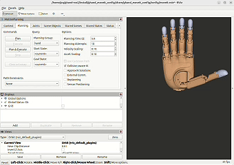
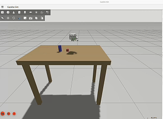

# GHand-ROS2

[English](README.md) · [安装与编译](docs/INSTALLATION_CN.md) · [接口参考](docs/ROS2_INTERFACE_REFERENCE_CN.md)

GHand 五指灵巧手的 ROS 2 Humble 控制栈，支持 GHand5、Lite1、单手及同型号双手。
按任务选择：**MoveIt 规划预览、Gazebo 物理仿真、实机控制**。




## 环境与产品

Ubuntu 22.04、ROS 2 Humble、C++17、Python 3.10；物理仿真使用 Gazebo Fortress。
先按[安装指南](docs/INSTALLATION_CN.md)克隆源码和独立模型资产、安装依赖并编译。

| 产品 | `product_name` | 反馈 / 主动关节数 | 控制能力 |
| --- | --- | --- | --- |
| GHand5 | `ghand5`（默认） | 18 / 13 | 位置模式、速度模式、力矩模式、MIT 模式、自定义模式 |
| GHandLite1 | `ghandlite1` | 11 / 6 | 位置模式、速度模式、力矩模式、自定义模式 |

GHandLite1 采用半闭环控制，不提供闭环、MIT 或 kp/kd 接口。ROS 侧的速度模式使用速度百分比命令（`velocity_percent`），单位不是 rad/s；力矩模式使用电流百分比命令（`current_percent`），不提供以 Nm 为单位的力矩接口。详见[硬件接口说明](ghand_hardware/ghand_hardware_interface/README.zh.md)。

两种产品均提供单手、双手、Gazebo 和 MoveIt 配置。配置存在不代表已通过实机验证。
Lite1 触觉资源按当前 SDK 元数据声明；实际支持情况需结合设备、固件及实机验证确认。

## 选择使用场景

| 场景 | 命令参数 | 能否执行轨迹 | 是否模拟接触 |
| --- | --- | --- | --- |
| MoveIt 规划预览 | `backend:=preview` | 仅规划和展示 | 否 |
| Gazebo 仿真 | `backend:=gazebo` | Gazebo 中执行 | 是 |
| 实机控制 | `backend:=hardware` | 实机执行 | 真实接触 |

所有场景统一使用 `ghand_bringup start.launch.py`。默认 Gazebo、右手、启用 MoveIt。
每次只启动一个场景；切换前用 Ctrl+C 退出，避免重复创建节点和控制器。

按安装指南完成编译后，每个新终端先进入工作空间根目录，再加载环境。请将 `<workspace>` 替换为实际的工作空间路径：

```bash
cd <workspace>
source /opt/ros/humble/setup.bash
source install/setup.bash
```

### 1. MoveIt 规划预览

```bash
ros2 launch ghand_bringup start.launch.py backend:=preview
```

在 RViz 的 MotionPlanning 面板选择目标状态并点击 **Plan** 查看轨迹。
预览使用固定的初始关节状态，不启动控制器，不执行轨迹；不要使用 Execute 或 Plan & Execute。
需要验证运动和执行结果时使用 Gazebo 或实机。

### 2. Gazebo 物理仿真

```bash
ros2 launch ghand_bringup start.launch.py backend:=gazebo
```

启动 Gazebo、控制器、MoveIt 和 RViz。在 RViz 中使用 **Plan & Execute**，轨迹由 Gazebo 执行。
只使用 Topic / Action 控制、不需要规划时添加 `planning:=false`。

另开终端验证：

```bash
ros2 control list_controllers
ros2 topic echo /joint_states --once
```

`joint_state_broadcaster` 和 `joint_trajectory_controller` 应为 `active`。

### 3. 实机控制

先完成[实机连接指南](docs/HARDWARE_CN.md)中的设备识别、权限和接线检查。
下面以 RS485 右手为例，设备路径替换为实际值：

```bash
ros2 launch ghand_bringup start.launch.py \
  backend:=hardware hand:=right planning:=false \
  profile:=rs485_right device:=/dev/ttyUSB0
```

需要 MoveIt 规划执行时改为 `planning:=true`。实机模式必须显式指定 `backend:=hardware`。

```bash
ros2 control list_hardware_components
ros2 control list_controllers
ros2 topic echo /joint_states --once
ros2 topic echo /joint_status --once
```

确认硬件及轨迹控制器为 `active`、反馈正常，再发送运动命令。
CANFD 和 EtherCAT 的配置见[实机连接指南](docs/HARDWARE_CN.md)。
使用 EtherCAT 时，按指南为 `ros2_control_node` 授予 `cap_net_raw,cap_net_admin=ep`。

## 切换产品、左右手和双手

以下参数适用于三个场景：

```bash
# Lite1 左手规划预览
ros2 launch ghand_bringup start.launch.py \
  backend:=preview product_name:=ghandlite1 hand:=left

# 同型号双手 Gazebo 仿真
ros2 launch ghand_bringup start.launch.py backend:=gazebo hand:=dual

# 双手实机，两路独立 RS485 串口
ros2 launch ghand_bringup start.launch.py \
  backend:=hardware hand:=dual planning:=false \
  left_profile:=rs485_left right_profile:=rs485_dual_right \
  left_device:=/dev/ttyUSB0 right_device:=/dev/ttyUSB1
```

## 控制与反馈

Gazebo 和实机默认共用轨迹接口；关节位置和轨迹使用弧度。

| 接口 | 单手路径 |
| --- | --- |
| 关节反馈 | `/joint_states` |
| 轨迹 Action（推荐） | `/joint_trajectory_controller/follow_joint_trajectory` |
| 轨迹 Topic | `/joint_trajectory_controller/joint_trajectory` |
| 实机状态码 / 触觉 | `/joint_status` / `/tactile_data` |

双手关节使用 `left_`、`right_` 前缀，Action 分别位于
`/left_joint_trajectory_controller/follow_joint_trajectory` 和
`/right_joint_trajectory_controller/follow_joint_trajectory`。
实机专用反馈位于 `/left/`、`/right/` 下。

位置、速度百分比、电流百分比直接控制，以及控制器切换、消息字段和产品能力限制，见[接口参考](docs/ROS2_INTERFACE_REFERENCE_CN.md)。

## 文档与维护

- [安装与编译](docs/INSTALLATION_CN.md) · [实机连接](docs/HARDWARE_CN.md)
- [启动参数与迁移](ghand_bringup/README.zh.md)
- [MoveIt 规划预览](ghand_moveit_config/README.zh.md) · [Gazebo](ghand_gazebo/README.zh.md)
- [ROS 2 接口参考](docs/ROS2_INTERFACE_REFERENCE_CN.md) · [版本记录](CHANGELOG.md)
- [官方文档](https://fcnzogxju7xr.feishu.cn/docx/AhZ6ds2iCoguaAxIzBxciYHinNo) · [GLI SDK](https://github.com/gli-sdk)

启动输出使用 ROS 原生日志，完整日志保存在 launch 提示的目录中。
更新后重新编译并 source 工作空间。可用 `backend:=mock` 在不连接实机、不启动 Gazebo 的情况下验证轨迹控制器；物理仿真和实机验证分别使用 `gazebo` 和 `hardware` 后端。

问题请提交仓库 Issue，或联系 support@glitech.com。许可证：[Apache 2.0](LICENSE)。

真实硬件链接项目内随附的 GHand C++ SDK 动态库，运行 `build.sh` 即可构建，无需本地 SDK 源码目录；纯仿真使用 `build.sh --simulation`。
